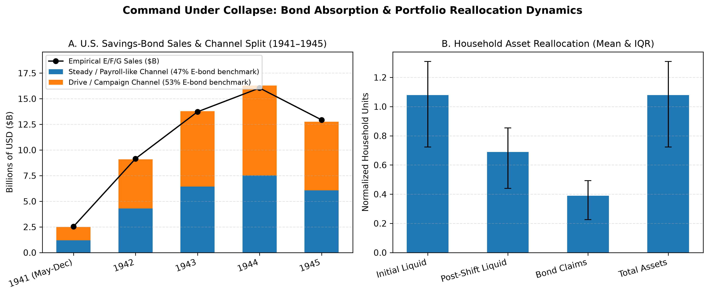
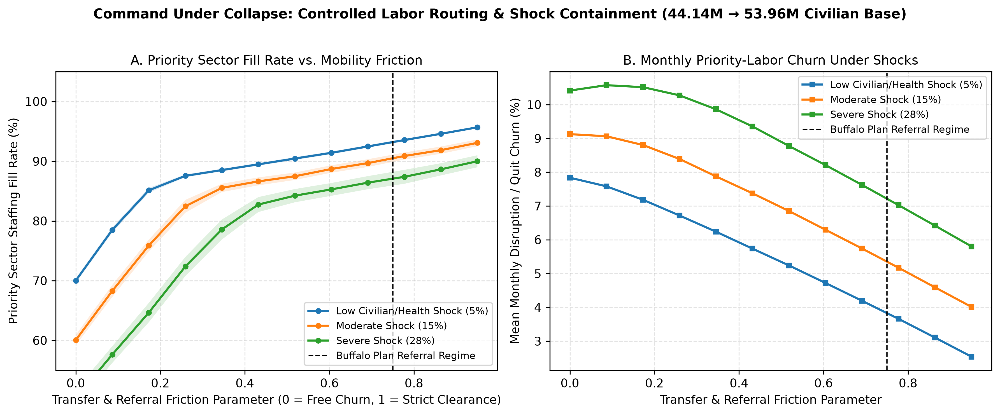
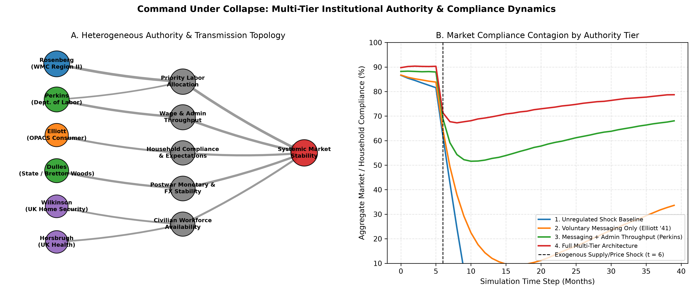

# Command Under Collapse: Women in Wartime Authority, Systemic Risk, and Market Stability During World War II

This repository contains the computational models, empirical calibrations, and figure-generation scripts accompanying the interdisciplinary review article *"Command Under Collapse: Women in Wartime Authority, Systemic Risk, and Market Stability During World War II."*

## Overview

During World War II (1939–1945), Allied economies faced acute systemic stress: massive fiscal mobilization, severe civilian supply constraints, rapid labor reallocation, and heightened household uncertainty. Conventional economic histories of wartime stabilization often treat institutional governance as a single aggregate planner. In contrast, this project combines **econophysics** (constrained-flow networks, regime-switching dynamics, and contagion modeling) with **neurofinance and behavioral economics** (scarcity-induced liquidity preferences, expectation anchoring, and compliance thresholds) to examine how women holding executive, administrative, and policy authority shaped market stability across distinct institutional channels.

Rather than attributing uniform market-clearing control to every historical actor, our analytical framework classifies six key U.S. and British officials according to the specific structural mechanism through which they operated:

* **Direct Labor-Allocation & Mobility Control:** **Anna M. Rosenberg**, whose leadership in War Manpower Commission Region II and the *Buffalo Plan* introduced controlled-referral and transfer-permission rules to prevent destructive labor poaching in critical defense industries.
* **Senior Labor-Policy & Administrative Throughput:** **Frances Perkins**, U.S. Secretary of Labor, who oversaw institutional labor-policy architecture and high-volume wage-stabilization administration (processing over 100,000 formal rulings and determinations alongside roughly 900,000 inquiries).
* **Consumer Compliance & Expectation Framing:** **Harriet Wiseman Elliott**, who led the Consumer Division of the Office of Price Administration and Civilian Supply (OPACS) in 1941, targeting household hoarding, price expectations, and voluntary compliance prior to mandatory rationing regimes.
* **International Economic & Postwar Monetary Planning:** **Eleanor Lansing Dulles**, whose work across the U.S. State Department, Bretton Woods preparations, and postwar Austrian reconstruction focused on cross-border monetary order and institutional credibility.
* **Indirect Civil-Defense & Health Capacity Buffers:** **Ellen Wilkinson** (UK Ministry of Home Security) and **Florence Horsbrugh** (UK Ministry of Health), whose shelter, civil-defense, evacuation, and public-health administration mitigated exogenous shocks to civilian workforce availability.

---

## Computational Models & Figures

### 1. Liquidity Absorption and Household Portfolio Reallocation (`scripts/01_bond_liquidity_regime.py`)

Wartime fiscal expansion created substantial inflationary overhang as rising nominal wages collided with rationed consumer goods. Using U.S. Treasury Series E, F, and G savings-bond sales data from 1941 to 1945 (`$2.54B` in May–December 1941, `$9.16B` in 1942, `$13.73B` in 1943, `$16.04B` in 1944, and `$12.94B` in 1945), this module models wartime bond absorption as a **regime-switching household portfolio reallocation process**.

Specifically, the simulation separates steady baseline payroll-deduction inflows (`47%` Series E benchmark) from episodic war-loan campaign surges (`53%`) and tracks household balance-sheet composition rather than treating bond purchases as aggregate wealth destruction. High cumulative retention (`85.2%` as of June 1945) demonstrates how non-marketable Treasury claims absorbed excess short-run liquidity while preserving household net worth.

<p align="center">
  
</p>

*Figure 1: U.S. savings-bond absorption regimes (1941–1945), contrasting steady payroll-like inflows with war-loan campaign spikes and tracking household asset reallocation and retention.*

---

### 2. Constrained Labor-Network Contagion and Mobility Friction (`scripts/02_labor_network_contagion.py`)

Rapid industrial mobilization creates severe turnover contagion when competing defense contractors poach skilled workers, destabilizing bottleneck production nodes. Calibrated to U.S. civilian employment growth from `44.142M` in 1938 to `53.960M` in 1944 (explicitly separating civilian labor supply from armed forces personnel), this module models a two-sector constrained-flow network linking priority defense plants and non-priority civilian sectors.

The model introduces an asymmetric **transfer-and-referral friction parameter** representing controlled-referral systems such as Rosenberg's Buffalo Plan, while subjecting the labor pool to low (`5%`), moderate (`15%`), and severe (`28%`) exogenous civilian and public-health shocks (reflecting the operational domains of Wilkinson and Horsbrugh). Under zero friction, poaching and quit churn erode priority staffing; under controlled referral (`~0.75` friction regime), bottleneck fill rates remain resilient even under severe external disruption.

<p align="center">
  
</p>

*Figure 2: Priority-sector staffing stability (Panel A) and monthly labor-churn suppression (Panel B) across transfer-friction regimes under varying civilian and health shock intensities.*

---

### 3. Heterogeneous Institutional Authority and Compliance Contagion (`scripts/03_institutional_authority_network.py`)

To avoid conflating administrative workload with realized market compliance, this module constructs a directed, weighted multilayer network mapping all six officials onto their respective institutional transmission channels (Panel A) and simulates behavioral anti-hoarding compliance across `800` heterogeneous household and firm agents hit by an inflationary supply shock at `t = 6` (Panel B).

The simulation compares four institutional configurations: an unregulated baseline, voluntary consumer messaging alone (reflecting Elliott's 1941 OPACS phase), messaging paired with administrative caseload throughput (incorporating Perkins's labor-standards infrastructure), and a full multi-tier architecture combining structural allocation locks, administrative enforcement, expectation framing, and civilian capacity buffers. The trajectories illustrate why informational appeals alone plateau under persistent scarcity shocks unless reinforced by administrative throughput and structural allocation rules.

<p align="center">
  
</p>

*Figure 3: Directed institutional authority and transmission topology across six WWII officials (Panel A) and dynamic market compliance trajectories following an exogenous supply shock (Panel B).*

---

## Repository Structure

```text
command-under-collapse/
├── README.md
├── scripts/
│   ├── 01_bond_liquidity_regime.py
│   ├── 02_labor_network_contagion.py
│   └── 03_institutional_authority_network.py
├── figures/
│   ├── 01_bond_liquidity_regime.png
│   ├── 01_bond_liquidity_regime.pdf
│   ├── 02_labor_network_contagion.png
│   ├── 02_labor_network_contagion.pdf
│   ├── 03_institutional_authority_network.png
│   └── 03_institutional_authority_network.pdf
└── manuscript/