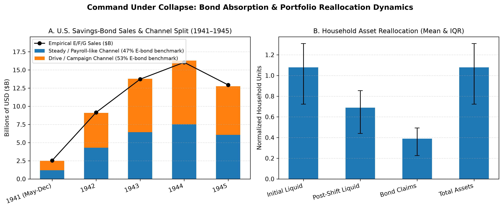
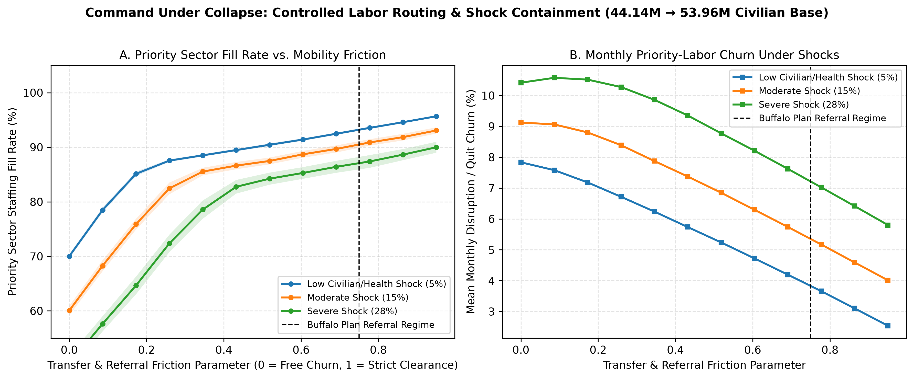
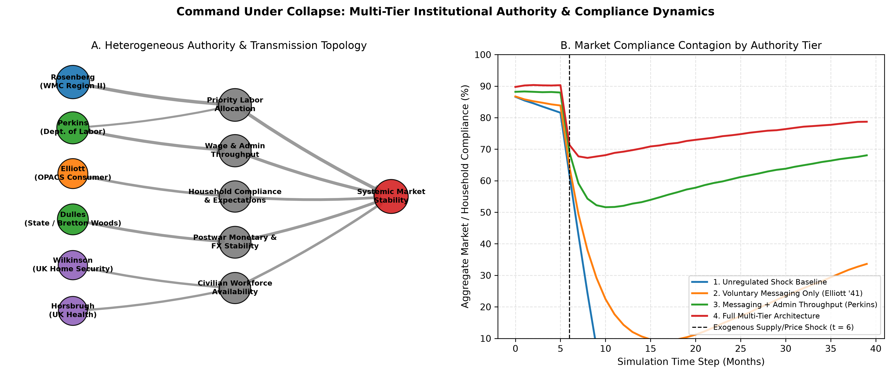

# Command Under Collapse: Women in Wartime Authority, Systemic Risk, and Market Stability During World War II

## Abstract

World War II (1939–1945) placed Allied economies under acute structural strain characterized by fiscal surge mobilization, physical supply ceilings in civilian markets, labor bottlenecks, and heightened household uncertainty. Traditional macroeconomic histories often analyze wartime stabilization through aggregate fiscal multipliers or centralized planning directives, treating institutional governance as a uniform apparatus and overlooking how distinct operational roles shaped systemic resilience. This review article develops an interdisciplinary synthesis linking **econophysics**—specifically constrained-flow networks, regime-switching dynamics, and contagion modeling—with **behavioral and neuroeconomic reasoning** on scarcity adaptation, liquidity preference, and compliance thresholds. We examine how six women holding executive, administrative, and policy roles—**Anna M. Rosenberg**, **Frances Perkins**, **Harriet Wiseman Elliott**, **Eleanor Lansing Dulles**, **Ellen Wilkinson**, and **Florence Horsbrugh**—interacted with wartime resource allocation and market stability. Rather than attributing uniform market-clearing control across offices, we classify their functions across five institutional tiers: (1) direct allocation and labor-mobility control, (2) senior labor-policy and administrative throughput, (3) consumer compliance and expectation framing, (4) international monetary and postwar planning, and (5) indirect civil-defense and public-health capacity buffers. We anchor these mechanisms to U.S. Treasury savings-bond sales (1941–1945), reconciled U.S. civilian employment records (1938–1944), and archival administrative records, integrating computational simulations from our companion repository.

---

## 1. Introduction

A wartime economy operates as a **constrained complex system** pushed close to physical, demographic, and financial boundaries. When defense production expands rapidly while civilian manufacturing capacity is curtailed or diverted to war goods, rising nominal incomes collide with scarce consumer supply. Without institutional buffering, this imbalance propagates through coupled channels: inflationary pressure and black-market diversion, precautionary or panic hoarding by households, destructive labor poaching and turnover cascades in bottleneck defense industries, and workforce attrition caused by civil-defense hazards or illness.

Standard macroeconomic accounts frequently treat wartime stabilization as an aggregate accounting problem—focusing on total war outlays, war-finance shares, or top-down controls—while giving insufficient attention to the **institutional friction points and behavioral mechanisms** through which policy operated on the ground. Yet wartime economic stability depended on how institutions managed three interlocking pressures: absorbing excess short-term household liquidity without undermining balance-sheet confidence, routing scarce labor toward high-priority plants while suppressing turnover contagion, and sustaining compliance and civilian capacity under recurring shocks.

Examining women in wartime authority during World War II offers a valuable vantage point for studying these mechanisms. Across the United States and the United Kingdom, women exercised consequential influence over labor-transfer rules, labor-standards administration, consumer and price-stabilization messaging, international monetary planning, and civil-defense and public-health administration. Viewing their work through an econophysics and behavioral/neurofinance lens allows us to pose a focused analytical question: **Through what distinct structural channels—and subject to what institutional scope conditions—did women in wartime authority mitigate contagion and support market stability under severe resource constraints?**

To address this question systematically, this article pairs historical verification with three computational simulation modules (`01_bond_liquidity_regime.py`, `02_labor_network_contagion.py`, and `03_institutional_authority_network.py`). These simulations are not intended as exact historical reconstructions of individual decisions; rather, they serve as structured analytical models for testing how regime shifts, constrained flows, and heterogeneous authority tiers shape systemic stability under stress.

---

## 2. Theoretical and Methodological Framework

### 2.1 Scarcity, Liquidity Overhang, and Portfolio Reallocation

In econophysics and behavioral economics, acute resource scarcity reshapes both physical resource flows and individual decision heuristics. Under wartime rationing and supply uncertainty, households face a trade-off between holding liquid purchasing power for immediate or precautionary consumption and shifting savings into longer-horizon, less liquid financial claims. Treating war-bond subscriptions simply as a reduction in household wealth misses their balance-sheet mechanics: savings-bond purchases represent **portfolio reallocation** from liquid cash or deposits into non-marketable Treasury claims. This lock-up absorbs near-term inflationary liquidity while preserving household asset claims over time.

From a neuroeconomic and behavioral perspective, scarcity heightens attention to immediate constraints, loss aversion, and social cues. Institutional arrangements that pair steady, habitual accumulation—such as payroll deduction—with periodic mobilization drives can shift marginal saving behavior, provided households trust the fiscal credibility and redemption terms of the issuer.

### 2.2 Constrained-Flow Networks and Labor Mobility Friction

In a wartime labor market, workers and enterprises form a **constrained flow network** shaped by skill specificity, geographic immobility, and production interdependencies. When defense contractors compete aggressively for scarce skilled workers without coordination rules, unrestrained job switching and poaching generate **turnover contagion**. Rather than acting as frictionless market adjustment, rapid churn disrupts assembly lines, inflates training overhead, and depresses output at critical bottleneck nodes even when overall employment is rising.

Controlled-referral and transfer-permission rules—such as those developed under **Anna M. Rosenberg** in War Manpower Commission (WMC) Region II and the **Buffalo Plan**—introduce targeted mobility friction on uncoordinated transfers while steering unassigned or incoming workers toward priority defense plants. In a constrained-flow framework, regulated friction is not automatically a deadweight loss; when calibrated to bottleneck congestion, it can dampen oscillatory turnover and stabilize throughput under external shocks.

### 2.3 A Heterogeneous Taxonomy of Institutional Authority

A frequent source of analytical imprecision in historical studies is treating officials with very different mandates as if they possessed identical levers over prices, wages, or production. To avoid overstating or misclassifying impact, we organize our six focal figures across **five institutional authority tiers**:

1. **Direct Allocation and Mobility Control:** Represented by **Anna M. Rosenberg** (WMC Region II and the Buffalo Plan), operating through controlled job referrals, transfer clearances, and localized manpower routing in priority defense markets.
2. **Senior Labor-Policy and Administrative Throughput:** Represented by **Frances Perkins** (U.S. Secretary of Labor), operating through institutional labor-standards administration, wage-stabilization processes, and high-volume case and inquiry handling.
3. **Consumer Compliance and Expectation Framing:** Represented by **Harriet Wiseman Elliott** (head of the Consumer Division in the Office of Price Administration and Civilian Supply, OPACS, in 1941), operating through consumer information, anti-hoarding norms, and voluntary compliance prior to mandatory rationing.
4. **International Economic and Postwar Monetary Order:** Represented by **Eleanor Lansing Dulles** (U.S. State Department, Bretton Woods preparations, and postwar Austrian financial reconstruction), operating through cross-border monetary planning and institutional stabilization.
5. **Indirect Civil-Defense and Health Capacity Buffers:** Represented by **Ellen Wilkinson** (UK Ministry of Home Security) and **Florence Horsbrugh** (UK Ministry of Health), operating through civil defense, shelter and disruption management, evacuation, and public-health administration that protected civilian safety and workforce availability.

Separating these tiers makes clear why their effects differ in kind and timescale. Expectation framing shapes norms and voluntary restraint; administrative throughput processes rules and disputes at scale; direct allocation alters physical labor flows; and civil-defense and health measures protect the underlying civilian capacity that sustains economic production.

---

## 3. Empirical Anchors and Computational Synthesis

### 3.1 Household Liquidity Absorption and Portfolio Reallocation (1941–1945)

Between May 1941 and the close of 1945, U.S. Treasury Series E, F, and G savings bonds absorbed substantial household purchasing power across successive stages of mobilization: **$2.54 billion** in May–December 1941, **$9.16 billion** in 1942, **$13.73 billion** in 1943, **$16.04 billion** in 1944, and **$12.94 billion** in 1945. Historically, these inflows combined steady baseline accumulation—such as payroll savings plans, reflected in our **47%** Series E steady-accumulation benchmark—with high-intensity war-loan drives accounting for the remaining **53%** campaign component.

**Figure 1** (`scripts/01_bond_liquidity_regime.py`) models this trajectory as a regime-switching portfolio reallocation process. Two empirical and theoretical takeaways stand out. First, because savings bonds shifted liquid purchasing power into non-marketable claims rather than erasing household net worth, they dampened immediate spending pressure on scarce goods while maintaining household balance sheets. Second, cumulative retention across Series E–G reached **85.2%** as of June 1945, indicating that bond absorption was durable rather than immediately reversed through mass redemptions.

### 3.2 Labor-Network Contagion and Controlled-Referral Friction (1938–1944)

Accurate modeling of wartime labor supply requires separating civilian workers from armed forces personnel. Aggregate employment figures that combine military personnel with civilian workers (reaching **65.370 million** total employed in 1944) conflate defense mobilization with domestic civilian labor capacity. Grounding our model in the reconciled U.S. civilian employment series—which rose from **44.142 million** in 1938 to **53.960 million** in 1944—isolates the civilian workforce available to sustain industrial and essential civilian activity.

Within this expanding civilian labor pool, intense competition for skilled workers risked triggering destructive turnover cascades across defense plants. Controlled-referral and transfer-permission rules—exemplified by Rosenberg's regional administration and the Buffalo Plan—curbed unvetted job hopping and directed workers toward priority defense needs, working alongside Perkins's Department of Labor labor-standards and wage-administration framework and, in the British context, civil-defense and public-health measures led by Wilkinson and Horsbrugh that buffered civilian workers against aerial disruption and illness.

**Figure 2** (`scripts/02_labor_network_contagion.py`) simulates a two-sector constrained labor network across varying transfer-friction levels and exogenous civilian/health shock intensities (**5%**, **15%**, and **28%**). When transfer friction is near zero, high quit and poaching churn erodes priority-sector staffing fill rates, and severe civilian or health shocks produce pronounced drops in bottleneck capacity. In contrast, under a controlled-referral regime (around a **0.75** friction setting), monthly churn is substantially lower and priority staffing remains more resilient even when external shocks intensify.

### 3.3 Heterogeneous Authority Tiers and Market Compliance Contagion

A critical distinction in institutional analysis lies between **administrative throughput** and **realized market compliance**. Records of the U.S. Department of Labor under Perkins illustrate large-scale administrative processing—exceeding **100,000 rulings and determinations** and roughly **900,000 inquiries**—which reflects institutional workload and regulatory processing rather than automatic compliance across every market participant. Similarly, Elliott's leadership of the OPACS Consumer Division in 1941 focused on consumer education, anti-hoarding norms, and voluntary restraint prior to mandatory rationing regimes, while Dulles contributed to international monetary planning across State Department postwar work, Bretton Woods preparations, and Austrian financial reconstruction.

**Figure 3** (`scripts/03_institutional_authority_network.py`) captures these differences in structure and dynamics. **Panel A** maps the six officials onto distinct institutional tiers and transmission channels feeding into systemic market stability. **Panel B** simulates behavioral compliance across **800** household and firm agents subjected to an inflationary supply shock at `t = 6` under four institutional configurations. Voluntary messaging alone raises compliance above an unregulated baseline, yet plateaus under sustained scarcity pressure because individual incentives to hoard or defect persist without binding constraints. Pairing messaging with administrative throughput improves stability, and combining structural allocation rules, administrative capacity, expectation framing, and civilian/health buffers achieves the strongest post-shock compliance.

---

## 4. Methodological Nuances and Scope Conditions

Three scope conditions govern how these findings should be interpreted:

1. **Asymmetric Institutional Reach:** None of the six officials exercised unchecked economy-wide command. Rosenberg's controlled-referral model operated within regional and operational constraints before broader adoption; Elliott's 1941 OPACS Consumer Division relied largely on voluntary compliance and public framing ahead of statutory rationing; Dulles worked within multi-actor diplomatic and monetary negotiations; and Wilkinson and Horsbrugh influenced economic stability indirectly through civil defense, shelter, evacuation, and health administration.
2. **Administrative Activity vs. Behavioral Outcomes:** High volumes of rulings and inquiries demonstrate substantial administrative effort and institutional reach, but cannot be read on their own as proof of universal compliance without independent behavioral or market evidence.
3. **Stylized Simulation Boundaries:** The econophysics and agent-based models in Figures 1–3 clarify structural trade-offs—such as portfolio liquidity lock-up, churn suppression under controlled referral, and limits to purely voluntary compliance—under controlled assumptions. They illuminate mechanisms rather than substituting for detailed archival micro-studies of individual firms, households, or ministries.

---

## 5. Conclusion

Approaching World War II stabilization through econophysics, behavioral and neuroeconomic reasoning, and institutional history shows that systemic resilience under extreme scarcity relies on **multi-layered, differentiated governance** rather than a single uniform command lever. Across liquidity absorption and portfolio reallocation, controlled labor routing, administrative throughput, consumer expectation framing, international monetary coordination, and civil-defense and health protection, women in wartime authority occupied distinct nodes that helped contain contagion and sustain production. Distinguishing these tiers sharpens historical evaluation of wartime administration and offers a structured framework for examining institutional stability during contemporary supply, financial, and systemic crises.

---

## References

* Dulles, E. L. (1942–1945). *U.S. Department of State Division of Postwar Programs & Bretton Woods Preparatory Records*. National Archives and Records Administration (NARA).
* Elliott, H. W. (1941). *Consumer Division Bulletins and Price-Stabilization Addresses*, Office of Price Administration and Civilian Supply (OPACS).
* Farmer, J. D., & Foley, D. (2009). The economy needs agent-based modelling. *Nature*, 460(7256), 685–686.
* Horsbrugh, F. (1939–1945). *Ministry of Health Parliamentary Statements and Evacuation/Public Health Reports*, UK Hansard & The National Archives (Kew).
* Mullainathan, S., & Shafir, E. (2013). *Scarcity: Why Having Too Little Means So Much*. Times Books.
* Perkins, F. (1946). *The Roosevelt I Knew*. Viking Press; and U.S. Department of Labor Annual Reports (1941–1945).
* Rosenberg, A. M. (1942–1944). *War Manpower Commission Region II Operational Records and the Buffalo Controlled-Referral Plan*. NARA RG 211.
* U.S. Department of the Treasury. (1946). *Annual Report of the Secretary of the Treasury on the State of the Finances for the Fiscal Year Ended June 30, 1945* (Series E, F, and G Savings Bond Sales and Redemptions).
* U.S. Bureau of the Census. (1975). *Historical Statistics of the United States, Colonial Times to 1970* (Series D 1–10: Civilian Labor Force and Employment, 1938–1944).
* Wilkinson, E. (1940–1945). *Ministry of Home Security Civil Defence and Shelter Administration Records*, UK Hansard & The National Archives (Kew).